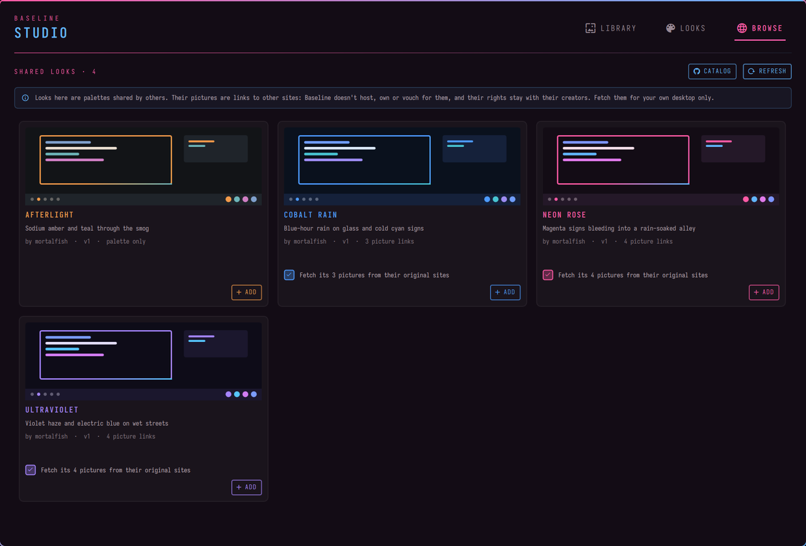

# Baseline looks

Colour schemes for **[Baseline](https://github.com/mortalfish-studio/baseline)**, a personal desktop system built on [Omarchy](https://omarchy.org) (Arch Linux + Hyprland). The mood is gritty neon noir: *Blade Runner 2049*, rain on Tokyo glass, sodium light through smog.

A look is a full palette that Baseline turns into Day, Night and Saver themes for the whole desktop: windows, bar, terminal, prompt, Chrome, the code editor, and even the mouse's lights. A look can also suggest pictures to go with it.



## What's in a look

Each folder in `looks/` holds three small files and nothing else:

| File | What it is |
|---|---|
| `look.json` | name, tagline, author handle, version |
| `colors.toml` | the palette: 25 named colours as `#rrggbb` |
| `pictures.json` | optional: **links** to pictures on their original sites, with credit |

There are no images, scripts or config files here. Baseline reads a look as data, checks every field, and writes its own theme files from the palette, so nothing in this repository ever runs on your machine.

## Pictures: links only

This repository **doesn't host any pictures**. A look's `pictures.json` lists where each picture lives (its page, its direct image link, who uploaded it, and its original source where known). When you add a look in Baseline you choose whether to fetch them, and they download straight from those sites to your machine.

> **Please read:** the pictures belong to their creators, not to this project. We don't own them, can't vouch for their licences, and aren't responsible for what the linked sites serve. Fetch them for your own desktop only. If you own a picture that's linked here and want it gone, [open an issue](../../issues) and the link will be removed.

To keep that honest:
- Paid stock photos (iStock, Shutterstock, Getty and the like) are never linked, even when someone has re-uploaded them elsewhere.
- Pictures may only come from a short list of sites (Wallhaven, Unsplash, Wikimedia), as jpg, png or webp, eight at most per look.
- A look without picture links is welcome: palette-only is the default.

## Getting a look

In Baseline: **Studio → Browse**, pick a look, **Add**. Updates show up there too.

## Sharing a look

In Baseline: open the look in **Studio → Looks**, choose **Share…**, check what will be published, and confirm. Baseline opens a pull request here. Every pull request is checked automatically (`tools/validate.py`) and reviewed by hand before it's merged.

Rules:
- the palette is your own work
- an author handle only: no real names, emails or anything personal
- pictures as links, with credit, from the allowed sites, no stock photos

You can also open a pull request by hand: copy the format of an existing look and run `python3 tools/validate.py` first.

## About Baseline

[Baseline](https://github.com/mortalfish-studio/baseline) is one person's Omarchy setup that grew into a small system, open source (MIT) for anyone to take apart and reuse:
- **the bar panel**: system readout, music player, status, wallpapers, looks, and setup (mouse lighting and buttons, dictation, health)
- **Baseline Studio**: picture library and look maker, including a palette suggested from a picture
- **[OmaRelay](https://github.com/mortalfish-studio/omarelay)**: voice control for switching workspaces, opening apps and handing off questions and coding tasks
- **health check & repair**: puts everything back after an Omarchy update
- **a clean uninstall**: the installer takes a snapshot first, and `afterlight uninstall` puts your system back as it was


It's built around the tools it was made with:
- [T3 Code](https://github.com/pingdotgg/t3code) as the coding agent
- [Grok Bot](https://x.ai/bot) for chat
- [Superwhisper](https://superwhisper.com) for dictation
- [Google Chrome](https://www.google.com/chrome/), with a small add-on that drives [Beatport](https://www.beatport.com) and [YouTube Music](https://music.youtube.com)

Swapping in your own coding and chat apps (Herdr, Claude, ChatGPT…) starts in Setup → Apps; see [adapting Baseline](https://github.com/mortalfish-studio/baseline/blob/main/docs/adapting.md).

To try it on an Omarchy machine (read [what it changes](https://github.com/mortalfish-studio/baseline/blob/main/docs/system-changes.md) first):

```bash
bash <(curl -fsSL https://raw.githubusercontent.com/mortalfish-studio/baseline/main/install.sh)
```

**Built on one machine:** a Microsoft Surface Laptop 7 (Snapdragon X Elite, ARM64, 2304×1536 at 1.5×) with a **Razer Basilisk V3** mouse. Most of Baseline is ordinary Omarchy configuration, but two parts are tied to that hardware:
- **The mouse lighting and extra buttons** read the Basilisk V3 directly. They're unlikely to work with any other mouse without real changes.
- **Battery care** uses the Surface's battery driver.

Expect to tinker: this is a plaything, not a product, and comes with no support. The looks themselves work on any Omarchy machine.

## Licence

The palettes and descriptions are public domain ([CC0](LICENSE)). Linked pictures aren't covered: they belong to their owners.
